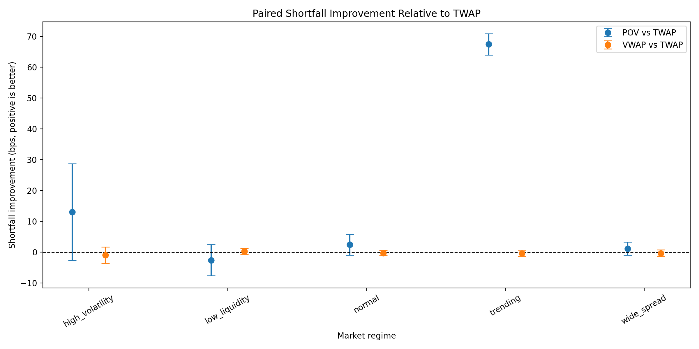
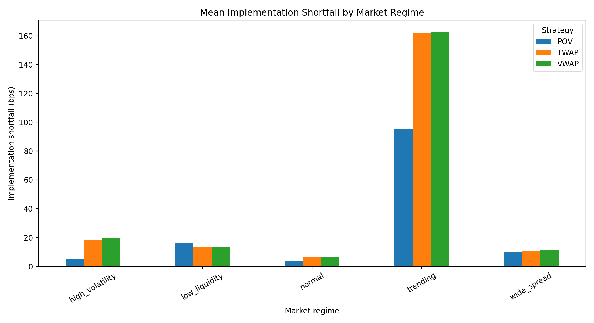
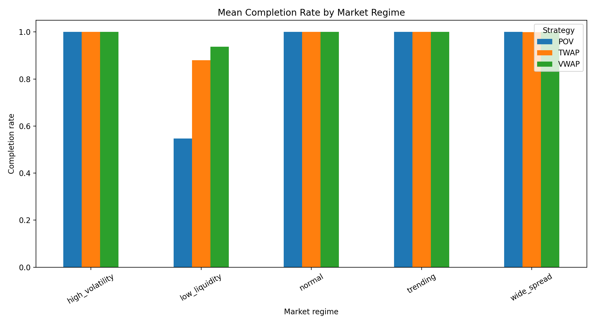

# Execution Cost Analysis

A Python simulation framework for comparing TWAP, forecast-volume VWAP and percentage-of-volume (POV) execution strategies under different synthetic market conditions.

This project asks a practical question: how do execution schedules behave when volatility, liquidity, spreads and price trends change? It models the trade-off between transaction cost, market impact and order completion rather than assuming that one strategy is universally best.

## Features

- Synthetic intraday markets with U-shaped volume profiles
- Normal, high-volatility, low-liquidity, wide-spread and trending regimes
- TWAP, forecast-volume VWAP and POV scheduling
- Bid-ask spreads, order-book depth and participation constraints
- Partial fills, transaction fees and temporary market impact
- Execution VWAP, implementation shortfall and completion-rate metrics
- Reproducible Monte Carlo experiments using matched random seeds
- Paired strategy comparisons with 95% confidence intervals
- Automated tests for models, metrics, strategies and simulation behaviour

## Execution strategies

**TWAP** divides the parent order equally across all execution intervals.

**VWAP** allocates quantity using a forecast U-shaped volume profile. Realised volume is not used when constructing the schedule, avoiding look-ahead bias.

**POV** submits a fixed percentage of the market volume observed during each interval, subject to the remaining parent quantity.

## Market and execution model

Each five-minute market snapshot contains:

- Bid and ask prices
- Market volume
- Bid and ask depth
- Volatility
- Market regime

An aggressive buy executes from the ask, while an aggressive sell executes from the bid. Temporary impact follows a square-root participation model:

```text
impact = coefficient × midpoint × volatility × sqrt(fill quantity / market volume)
```

Fill quantity is restricted by:

```text
min(child quantity, participation limit, opposite-side depth)
```

Implementation shortfall includes executed cost relative to the arrival price, fees and the opportunity cost of any unfilled quantity.

The simulator is deliberately simplified: it is intended for execution-analysis experiments, not live trading or price prediction.

## Experiment

The included analysis runs:

- 100 matched simulations per market regime
- 78 five-minute intervals per session
- A 500,000-unit buy order
- 7.8 million units of baseline daily market volume
- A 10% POV target
- A 20% maximum simulator participation rate

Each strategy is evaluated on the same generated market path for a given seed. This allows paired comparisons to remove much of the noise caused by general market movement.

Run the complete experiment with:

```bash
python -m execution_cost.run_analysis
```

Generated tables and figures are written to `results/`.

## Results

The simulation demonstrates that strategy selection depends on market conditions and execution urgency.

- In the trending regime, POV improved implementation shortfall over TWAP by **67.39 bps**, with a paired 95% confidence interval of **[63.98, 70.80] bps** and no material completion trade-off.
- In low liquidity, VWAP improved mean completion by approximately **5.73 percentage points** relative to TWAP, while its cost difference was statistically inconclusive.
- Low-liquidity POV completed only **54.7%** of the order, approximately **33.31 percentage points below TWAP**, without a statistically clear cost benefit.
- In the remaining regimes, paired cost confidence intervals crossed zero. The observed differences therefore cannot be distinguished clearly from simulation noise.

POV’s trending-market advantage should be interpreted as an urgency effect: at a 10% participation rate, it completed the buy order earlier and avoided more of the subsequent upward price movement.







## Installation

Python 3.10 or later is recommended.

```bash
git clone 
cd execution-cost-analysis

python3 -m venv .venv
source .venv/bin/activate

pip install -e ".[dev]"
```

Run the test suite:

```bash
pytest -v
```

Run the analysis:

```bash
python -m execution_cost.run_analysis
```

## Project structure

```text
src/execution_cost/
├── experiments.py       # End-to-end strategy comparison
├── market.py            # Synthetic markets and regimes
├── metrics.py           # Cost and benchmark calculations
├── models.py            # Orders, fills and market snapshots
├── monte_carlo.py       # Repeated simulation and aggregation
├── paired_analysis.py   # Paired differences and confidence intervals
├── plotting.py          # Result visualisations
├── reporting.py         # DataFrame output
├── run_analysis.py      # Reproducible experiment entry point
├── simulator.py         # Liquidity, impact and fill simulation
└── strategies.py        # TWAP, VWAP and POV scheduling
```

## Limitations

- Market paths are synthetic and do not reproduce full limit-order-book dynamics.
- Only aggressive execution is modelled; passive orders and queue position are excluded.
- Temporary impact does not persist into future intervals.
- The expected volume profile is fixed rather than estimated from historical data.
- Results depend on the selected order size, participation limits and regime parameters.
- Confidence intervals describe this simulation, not expected performance in real markets.

Possible extensions include historical market-data calibration, passive-order modelling, adaptive participation rates and separating spread, impact and timing components of implementation shortfall.